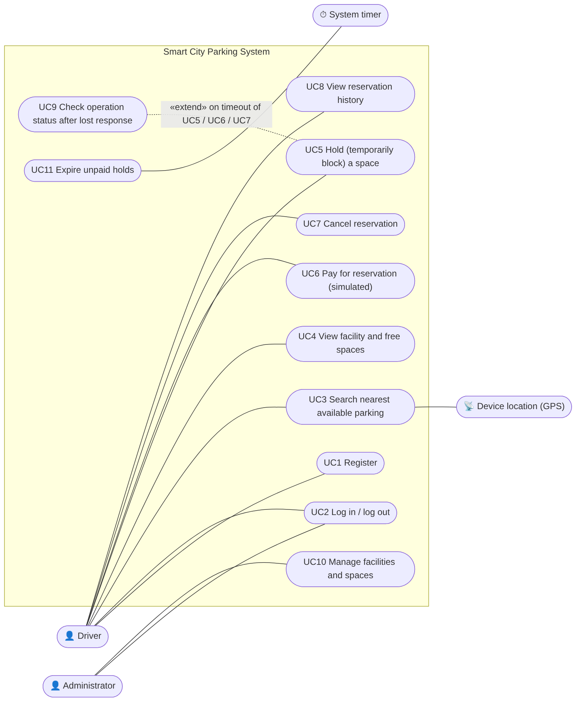
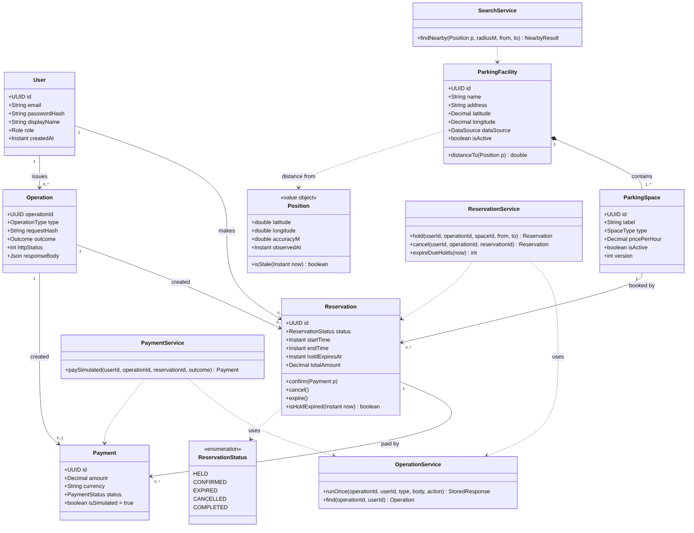
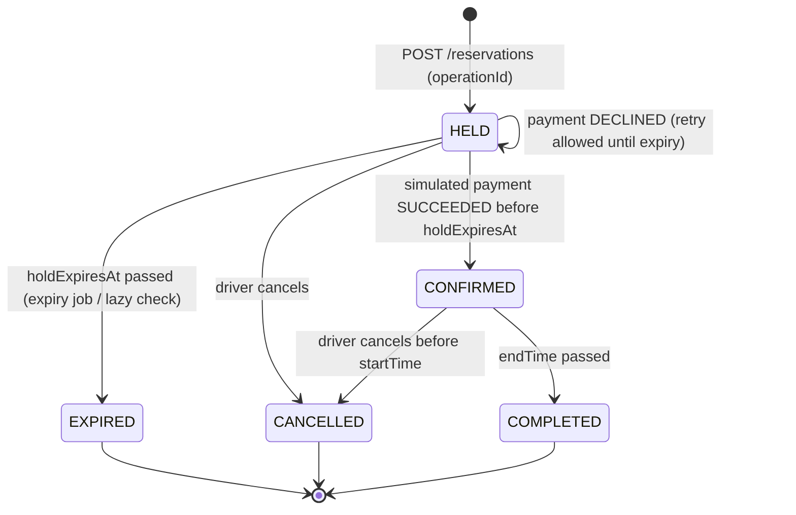
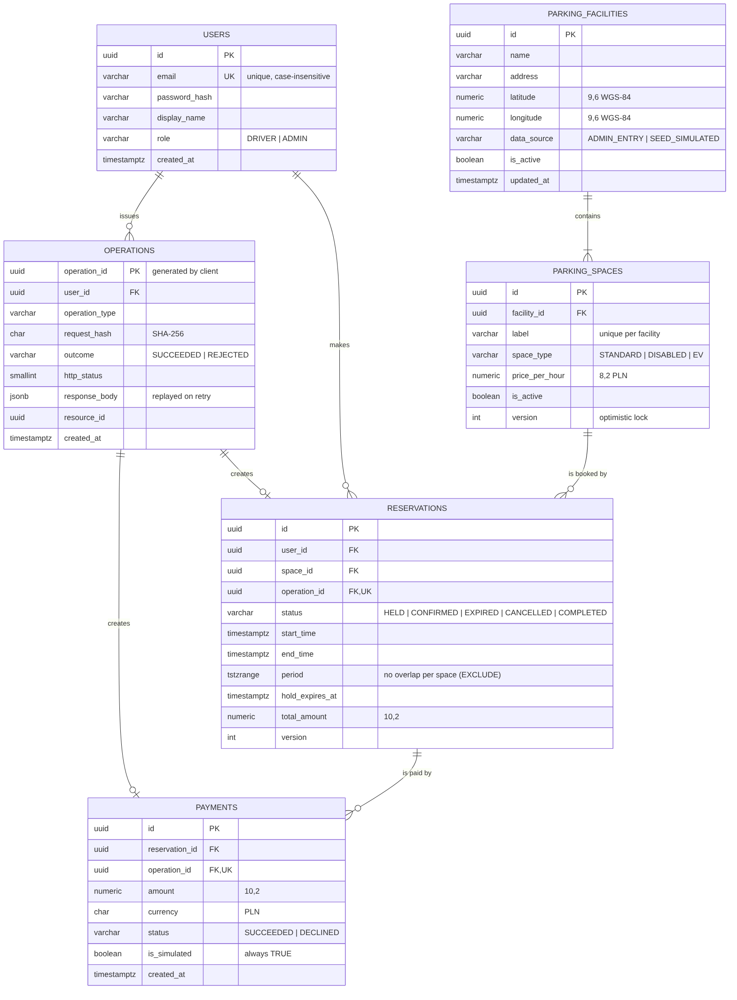
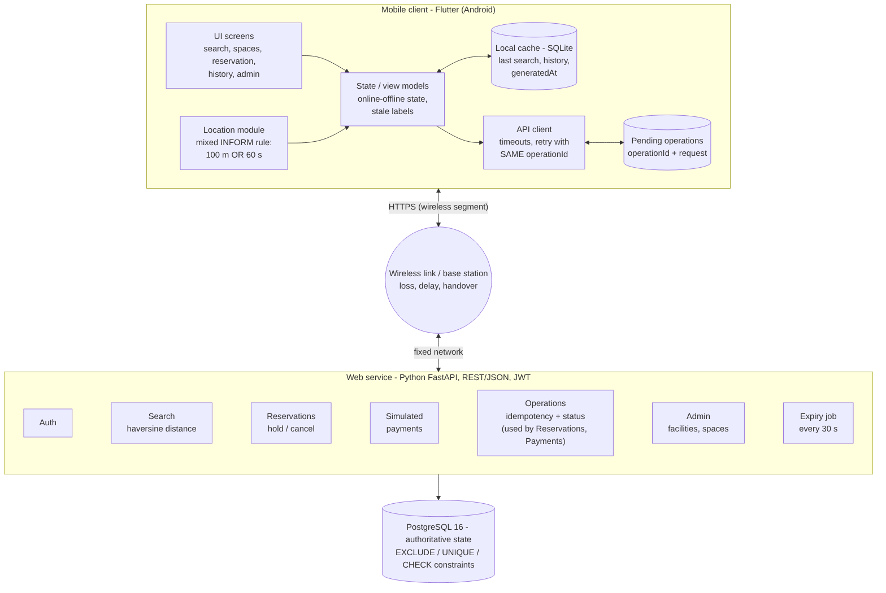
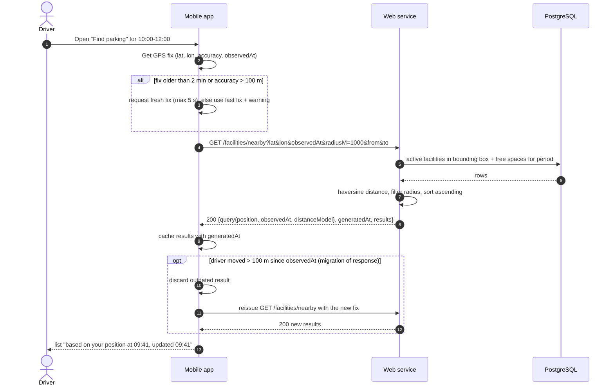
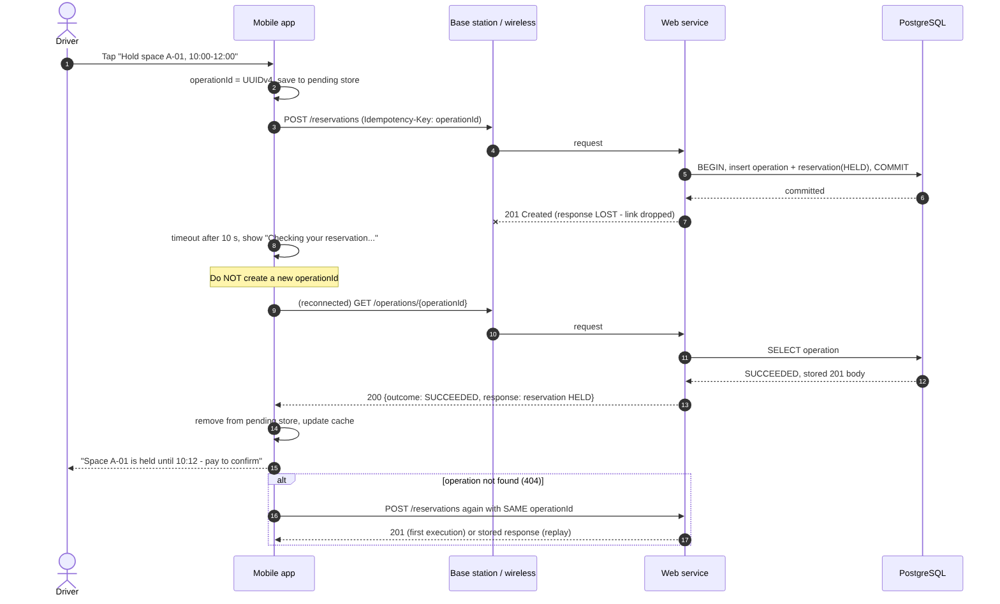
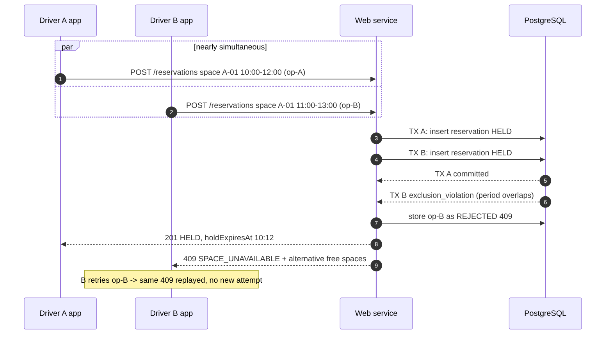

# PROJECT DOCUMENTATION

Subject: Networking Issues in Mobile Systems

## Part 1 – Conceptual Design

Project Topic: Smart City Parking System (Project B – alternative topic approved by the instructor)

## 1. General Information

**Project Name:** Smart City Parking System

**Project Authors:** Yiğit Demir, student ID 56442 – individual project (approved by the instructor)

**Field of Study:** Computer Science

**Year / Semester:** 4th year / 7th semester, academic year 2026/2027

**Supervisor:** Marcin Kacprowicz

**Submission Date:** 05.10.2026

**Git repository:** <https://github.com/yigitdemirr/smart-city-parking> – demonstrated revision: tag `m1`{{COMMIT}}

## 2. Project Description

### 2.1. Project Objective

The aim of the project is to create a mobile application that helps a driver find the nearest parking facility with a free space, temporarily block (hold) that space, confirm it with a **simulated** payment and keep a history of reservations. An administrator manages facilities and spaces through the web service.

The value for the user is a reservation that stays correct even when the mobile connection is unreliable. The main problem studied in this project comes from the lecture on mobile databases: the server can **process** a request correctly while the **delivery** of the answer to the moving user fails. The design therefore makes every data-changing request safe to repeat and lets the client find out afterwards what the server actually did.

### 2.2. Project Scope

| Module | Role |
|---|---|
| **Mobile application** (Flutter, Android) | User interface for drivers and the administrator; reads the device position with its observation time; keeps a read-only local cache (last search, history) with timestamps; keeps pending data-changing operations for recovery after a lost response. |
| **Web Service** (Python FastAPI, REST/JSON) | Business logic and validation; authentication and authorisation (JWT, roles); location-dependent search; holds, simulated payments and cancellations; duplicate protection and operation-status queries; automatic expiry of unpaid holds. It is the **coordinating server** that records the authoritative outcome of every change. |
| **Database** (PostgreSQL 16) | Stores users, facilities, spaces, reservations, simulated payments and operation records. Constraints guarantee consistency (no double booking, one successful payment per reservation, payments always simulated). |

**Out of scope:** real payments (every payment is simulated and labelled as such), real occupancy sensors, road-network routing and push notifications. They are listed as extensions in Section 8.

### 2.3. Technologies

| Layer | Technology | Reason |
|---|---|---|
| Mobile client | Flutter (Dart), Android target; SQLite (`sqflite`) cache; `geolocator` for GPS | One code base; the Android emulator can simulate loss of connectivity |
| Web service | Python 3.12, FastAPI, Uvicorn, JWT | Simple REST/JSON service with automatic OpenAPI documentation |
| Database | PostgreSQL 16 (`btree_gist`, `pgcrypto`) | Transactions, range types and exclusion constraints prevent double booking inside the database |
| Contract and diagrams | OpenAPI 3.0.3 (`api/openapi.yaml`), Mermaid sources (`docs/diagrams/*.mmd`) | Text files versioned in Git together with the code |
| Reproducible startup | Docker Compose (`docker-compose.yml`) | Same database for development and demonstration |

## 3. System Requirements

### 3.1. Functional Requirements

| ID | Function Name | Description | Priority |
|---|---|---|---|
| F1 | User registration | The user can create an account with e-mail, password and display name. The e-mail is unique. | High |
| F2 | Login / logout | The user can log in (receives a JWT valid for 1 hour) and log out. | High |
| F3 | Position acquisition | The app obtains the device position with latitude, longitude, accuracy and observation time, using a mixed INFORM reporting rule (Section 3.3). | High |
| F4 | Nearest parking search | The driver can search for the nearest facilities with at least one free space for a chosen period within a radius (default 1000 m). | High |
| F5 | Facility details | The driver can view the spaces of a facility with availability for the chosen period, type and price. | High |
| F6 | Hold a space | The driver can temporarily block one space for a period (max 24 h). The hold lasts 10 minutes. | High |
| F7 | Simulated payment | The driver can pay for a held reservation with a simulated payment; success changes the reservation to CONFIRMED. The UI always shows "SIMULATED – no real money". | High |
| F8 | Cancel reservation | The driver can cancel a HELD reservation, or a CONFIRMED one before its start time. | Medium |
| F9 | Reservation history | The driver can view all reservations with their statuses, newest first. | Medium |
| F10 | Operation status | The client can ask whether a data-changing operation was executed (`GET /operations/{operationId}`). | High |
| F11 | Space administration | The administrator can create facilities and spaces, change prices and activate or deactivate spaces. | Medium |
| F12 | Hold expiry | The service expires unpaid holds after 10 minutes and marks finished reservations as COMPLETED. | High |
| F13 | Offline behaviour | The app shows its connectivity state, displays cached read-only data with its timestamp and blocks data-changing actions while offline. | High |

### 3.2. Non-Functional Requirements

| ID | Name | Description | Category |
|---|---|---|---|
| N1 | Performance | Server-side search answers in < 1 s for 1000 facilities; other requests ≤ 2 s on a development machine. Client timeouts: connect 5 s, reads 8 s, actions 10 s. | Performance |
| N2 | No double booking | Two active (HELD/CONFIRMED) reservations may never overlap on the same space; at most one successful payment per reservation. Enforced by database constraints. | Consistency |
| N3 | Idempotency | Every data-changing request can be repeated any number of times without a duplicate effect (stable operation identity, Section 6.4). | Reliability |
| N4 | Freshness transparency | Every read response contains `generatedAt`; location-based results also return the position used and its `observedAt`. Cached data is always shown with its age. | Reliability |
| N5 | Wireless traffic economy | No background location upload; the position is sent only with a search. At most 50 results; gzip compression; reads retried at most twice (1 s, 3 s). | Performance |
| N6 | Security | Passwords hashed with bcrypt; JWT authentication; ADMIN role for `/admin/*`; all input validated on the server; prices and amounts computed only on the server; HTTPS in deployment. | Security |
| N7 | Privacy | The server does not store a location history; the position is used only to answer one query. | Security |
| N8 | Reproducibility | Startup is documented in README and scripted (Docker Compose, SQL files); every demonstration refers to a Git revision. | Maintainability |
| N9 | Usability | The hold countdown uses the server value `holdExpiresAt`; simulated payments are clearly labelled; error messages tell the user what to do next. | Usability |
| N10 | Maintainability | API contract, schema and diagrams are text files in Git and change together with the code. | Maintainability |

### 3.3. Origin and Freshness of Data, Meaning of "Nearest"

**Facility and space data.** Locations, labels and prices are entered by an administrator (`data_source = ADMIN_ENTRY`) or loaded as simulated city data for Łódź (`SEED_SIMULATED`). They change rarely; `updated_at` records the last change.

**Availability.** There are no physical sensors in scope. A space is *available* for a period if no HELD or CONFIRMED reservation in the system's own database overlaps that period. Availability is computed at request time and is authoritative only at `generatedAt`. It can become stale while the answer travels to the device, so the app labels lists older than 2 minutes "may be out of date", and the server always re-checks availability when a hold is requested. A stale list can therefore never cause a double booking.

**User position – INFORM on the client (lecture slides 2–3).** The app uses the device's fused location provider with a **mixed rule**: while the search screen is open, a new fix is taken when the user has moved more than **100 m** or the last fix is older than **60 s**. A purely temporal rule wastes messages for a stationary user; a purely distance-based rule lets a fix become very old. The position is not uploaded in the background (N5, N7); it is sent only as a parameter of a search together with `observedAt` and `accuracyM`. If the fix is older than 2 minutes or less accurate than 100 m, the app tries to get a fresh fix for up to 5 s; otherwise it uses the last known position and says so.

**Uncertain position as a circle (slide 8).** The reported accuracy is treated as a circle of radius `accuracyM` around the position. Facilities whose distance is smaller than this radius are shown as "about here" instead of an exact distance, and the radius is returned in the response so the user knows how precise the ranking is.

**Why the SEARCH strategy is not needed (slides 4–5).** All communication is started by the client (request–response). The service never sends an unsolicited message to the device, so it never has to locate the user. Push notifications would introduce this problem and are listed as an extension.

**Meaning of "nearest" (slide 6).** Nearest = smallest **straight-line (great-circle, haversine) distance** in metres between the reported position and the facility coordinates, among active facilities with at least one free space for the requested period, within the radius. Ties are broken by lower price, then by name. The response states `distanceModel = STRAIGHT_LINE_HAVERSINE`. Known limitation: a facility across a river can be close in a straight line but far in the street-network graph; road distance is an extension.

**Cost of the query (slide 7).** The cost consists of locating the user (one GPS fix on the device), execution time (one indexed query on the server) and communication cost (one request and one compressed response limited to 50 results). Limiting the radius and the number of results is the chosen compromise between cost and accuracy.

### 3.4. Connectivity Policy: Reads versus Actions Requiring Confirmation

| Request class | Examples | While offline | Timeout / lost response |
|---|---|---|---|
| **Reads** (safe, no state change) | search, facility spaces, history, reservation details, operation status | Show the last cached result with its `generatedAt` and position time; no new request | Retry automatically at most 2 times (1 s, 3 s), then a "Retry" button |
| **Actions requiring server confirmation** | register, log in, hold, pay, cancel, admin changes | **Blocked, not queued.** The button is disabled with an explanation | Keep the pending operation; ask `GET /operations/{id}`; resend with the **same** operationId only if the server never executed it |

**Decision: offline changes are blocked, not queued.** Whether a space is free and whether a hold is still valid are decided only by the server at the moment the request arrives. A hold queued offline could be executed minutes later in a different situation (the space taken, the driver elsewhere), and a payment must never be executed silently later. Blocking keeps the user's model simple: an action is either confirmed by the server or not done. Only the *pending operation* of a request that was already sent is kept locally, for recovery (Section 6.4).

### 3.5. Requirements and Network-Scenario Matrix

Each row is a test case for Milestone M3. The scenarios cover every function and the required situations: loss before and after submission, timeout, delayed response, retry, cached display, reconnection and competing data-changing requests. The same matrix is kept in the repository as `docs/network-scenarios.csv` and `.md`.

{{SCENARIO_TABLE}}

## 4. UML Diagrams

### 4.1. Use Case Diagram

{width=85%}

| Actor | Responsibilities |
|---|---|
| Driver | Registers, logs in, searches for parking from the current position, holds a space, pays (simulated), cancels, views history. |
| Administrator | Maintains facilities and spaces (location, labels, prices, active flag). |
| Device location (GPS) | Supplies position, accuracy and observation time to the app. |
| System timer | Triggers the expiry of unpaid holds and the completion of finished reservations. |

| Use case | Main success scenario | Network-related extensions |
|---|---|---|
| UC3 Search | The app takes a fix (F3) → sends lat/lon/observedAt/period → the service returns facilities sorted by distance with `generatedAt` → the app caches and shows them. | Offline: cached list with its age (NS-04); delayed answer after movement: result rejected and query reissued (NS-05); stale fix (NS-06). |
| UC5 Hold | The driver selects a space and period → the app creates an operationId → the service checks availability and creates a HELD reservation (10 min) → the app shows a countdown. | Offline: blocked (NS-09); lost response: UC9 (NS-10, NS-11); double tap (NS-12); competing hold (NS-13). |
| UC6 Pay | The driver confirms → the service records a simulated payment and sets CONFIRMED in one transaction. | Lost response (NS-15); hold expires during delay (NS-16); decline and retry (NS-17). |
| UC7 Cancel | The driver cancels → status CANCELLED, space released. | Lost response / retry (NS-19); conflict with expiry (NS-20). |
| UC9 Check operation | After a timeout the app asks `GET /operations/{id}`; 200 → use the stored result; 404 → resend with the same id. | Used by UC5, UC6, UC7 and UC10 (NS-26). |

### 4.2. Class Diagram



The domain classes mirror the database tables. `Position` is a value object that always carries its `observedAt`, so a position can never be used without knowing how old it is. Responsibilities of the service classes:

* **SearchService** – location-dependent query and distance computation; never changes data.
* **ReservationService** – hold, cancel and expiry; relies on the exclusion constraint for competing requests.
* **PaymentService** – simulated payment and confirmation in one transaction.
* **OperationService** – executes a data-changing action exactly once per operationId, stores the response for replay and answers status queries.

### 4.3. State Diagram of a Reservation

{width=70%}

## 5. Database Design

{width=90%}

### 5.1. Tables, Keys and Relationships

| Table | Primary key | Foreign keys / unique keys | Relationship |
|---|---|---|---|
| users | id (UUID) | UNIQUE lower(email) | 1 user – 0..N reservations, 0..N operations |
| parking_facilities | id (UUID) | – | 1 facility – 1..N spaces |
| parking_spaces | id (UUID) | facility_id → parking_facilities; UNIQUE (facility_id, label) | 1 space – 0..N reservations |
| reservations | id (UUID) | user_id → users; space_id → parking_spaces; operation_id → operations (UNIQUE); EXCLUDE (space_id =, period &&) for HELD/CONFIRMED | 1 reservation – 0..N payments |
| payments | id (UUID) | reservation_id → reservations; operation_id → operations (UNIQUE); partial UNIQUE (reservation_id) WHERE status = SUCCEEDED | many declined attempts, one success |
| operations | operation_id (UUID, generated by the client) | user_id → users | 1 operation – 0..1 reservation or payment |

### 5.2. Data Types and Constraints

| Data | Type | Rule |
|---|---|---|
| Identifiers | UUID | Generated by the server (`gen_random_uuid()`), except operation_id, which the client generates |
| Coordinates | NUMERIC(9,6) | WGS-84 degrees (≈ 0.1 m precision); CHECK latitude −90..90, longitude −180..180 |
| Money | NUMERIC(8,2) price per hour, NUMERIC(10,2) amounts | PLN; never floating point; ≥ 0; amount = price × duration, computed on the server |
| Time | TIMESTAMPTZ | Stored in UTC, displayed in Europe/Warsaw |
| Reservation period | TSTZRANGE `[start, end)` (generated column) | end > start, at most 24 h; half-open, so 10:00–12:00 and 12:00–14:00 do not overlap |
| Status values | VARCHAR + CHECK | Reservation: HELD, CONFIRMED, EXPIRED, CANCELLED, COMPLETED; Payment: SUCCEEDED, DECLINED |
| Stored response | JSONB | Exact response body replayed for a repeated operationId |
| Version stamp | INTEGER `version` | Optimistic locking for admin edits and reservation state changes |
| Simulated payment | BOOLEAN `is_simulated` | CHECK (is_simulated) – a real payment cannot be recorded |

The schema was executed on PostgreSQL 16 and verified with `database/tests/constraints_test.sql` (Appendix B).

## 6. System Architecture

### 6.1. Modules and Their Interconnections



The architecture follows the path described in the lecture (slide 9): mobile client → wireless channel → **base station** (interface between the mobile client and the fixed network) → fixed network → web service → database, and back. The wireless segment is the expensive and unreliable part, so the design moves work to the fixed side: the service acts as the **agent** of the mobile client (slide 10), filtering and sorting the results on the server and sending only the short list the user needs.

| Component | Responsibility |
|---|---|
| UI screens | Login/Register, Find parking, Facility spaces, Reservation (countdown, simulated payment), History, Admin |
| State / view models | Online/offline state, which buttons are enabled, stale labels |
| Location module | Mixed INFORM rule (100 m or 60 s), accuracy and observation time |
| Local cache (SQLite) | Last search results and history with `generatedAt`; read-only replica |
| Pending-operations store | operationId and original request of every sent, unresolved action |
| API client | Timeouts, read retries, recovery through `/operations/{id}` |
| Web service modules | Auth, Search, Reservations, Simulated payments, Operations, Admin, Expiry job |
| PostgreSQL | Single source of truth; constraints guarantee consistency |

### 6.2. Logical Data Flow

**Location-dependent search.** If the answer arrives after the user has moved more than 100 m, the app applies the "reject the result and reissue the enquiry" solution for migration of responses (slides 17–18).



**Hold with a lost response – processing succeeded, delivery failed.** The database commit is the point after which the result exists even if the device never hears about it.



**Competing data-changing requests.**



### 6.3. Web Service Operations (API Contract)

Base URL `/api/v1`, JSON, `Authorization: Bearer <JWT>`. Data-changing requests carry the header `Idempotency-Key: <operationId>`. Errors use one format: `{"error": {"code", "message", "details"}}`. The full contract is in `api/openapi.yaml`.

| Method and path | Purpose | Main responses |
|---|---|---|
| `GET /health` | Service and database liveness | 200 |
| `POST /auth/register` | Register a driver | 201, 409 EMAIL_TAKEN, 422 |
| `POST /auth/login` | Obtain a JWT | 200, 401 |
| `GET /facilities/nearby` | Nearest facilities with free spaces (query: lat, lon, observedAt, accuracyM, radiusM, from, to, limit) | 200 with query echo and generatedAt, 422 |
| `GET /facilities/{id}/spaces` | Spaces and availability for a period | 200, 404 |
| `POST /reservations` | Hold a space for 10 min | 201, 409 SPACE_UNAVAILABLE, 422 |
| `GET /reservations`, `GET /reservations/{id}` | History; current authoritative state | 200, 404 |
| `POST /reservations/{id}/payment` | Simulated payment → CONFIRMED | 200, 402 PAYMENT_DECLINED, 409 HOLD_EXPIRED / ALREADY_PAID |
| `POST /reservations/{id}/cancel` | Cancel | 200, 409 ALREADY_CANCELLED / INVALID_STATE |
| `GET /operations/{operationId}` | Was the operation executed? | 200 (stored result), 404 (not executed) |
| `POST /admin/facilities`, `POST /admin/facilities/{id}/spaces`, `PATCH /admin/spaces/{id}` | Administration | 201/200, 403, 409 VERSION_CONFLICT / LABEL_TAKEN |

Representative request and response – search:

```text
GET /api/v1/facilities/nearby?lat=51.7700&lon=19.4600&observedAt=2026-12-01T08:41:05Z
    &accuracyM=15&radiusM=1000&from=2026-12-01T09:00:00Z&to=2026-12-01T11:00:00Z

200 OK
{ "query": { "position": {"lat": 51.77, "lon": 19.46, "accuracyM": 15,
                          "observedAt": "2026-12-01T08:41:05Z"},
             "radiusM": 1000, "distanceModel": "STRAIGHT_LINE_HAVERSINE" },
  "generatedAt": "2026-12-01T08:41:06Z",
  "results": [ { "facilityId": "10000000-...-003", "name": "Łódź Fabryczna",
                 "distanceM": 622, "freeSpaces": 2, "minPricePerHour": 3.50 } ] }
```

Representative request and response – hold:

```text
POST /api/v1/reservations
Authorization: Bearer eyJhbGciOi...
Idempotency-Key: 3b9d6f0e-2c4f-4f43-9d0a-1d3a2b7c9e11
{ "spaceId": "5f2a...", "startTime": "2026-12-01T09:00:00Z", "endTime": "2026-12-01T11:00:00Z" }

201 Created
{ "reservationId": "c0ffee00-...", "operationId": "3b9d6f0e-...", "status": "HELD",
  "spaceLabel": "C-01", "holdExpiresAt": "2026-12-01T08:52:10Z",
  "totalAmount": 7.00, "currency": "PLN" }
```

Representative request and response – recovery after a lost response:

```text
GET /api/v1/operations/3b9d6f0e-2c4f-4f43-9d0a-1d3a2b7c9e11

200 OK
{ "operationId": "3b9d6f0e-...", "type": "HOLD_SPACE", "outcome": "SUCCEEDED",
  "httpStatus": 201, "resourceId": "c0ffee00-...",
  "response": { "reservationId": "c0ffee00-...", "status": "HELD",
                "holdExpiresAt": "2026-12-01T08:52:10Z" } }
```

### 6.4. Duplicate Protection and Recovery after a Lost Response

**Stable operation identity.**

1. **Client.** When the user expresses an intent (e.g. taps *Hold*), the app generates one `operationId` (UUID v4) and saves `{operationId, method, path, body, createdAt}` in the pending-operations store **before** sending. Every retry of this intent reuses the same `operationId`; a new intent always gets a new one.
2. **Server – first execution.** The service computes `request_hash = SHA-256(method + path + canonical JSON body)`. In **one database transaction** it performs the business change (e.g. inserts the HELD reservation) and inserts the `operations` row with the outcome, HTTP status and full response body. Either both are committed or neither (atomicity, slide 13).
3. **Server – repeated request.** If the `operations` primary key already exists, the transaction is rolled back and the stored row is read: same user and same hash → the stored status and body are returned with header `Idempotent-Replay: true`; different hash → `422 IDEMPOTENCY_KEY_REUSED`; different user → `404`.
4. **Concurrent duplicates.** If two copies arrive at the same time, the second insert waits on the primary-key index until the first transaction commits, then fails and is answered by replay (isolation). Only one execution is possible.
5. **Business rejections are recorded too.** If a hold loses against a competing request (`exclusion_violation`) or a payment arrives after `holdExpiresAt`, the rejection (409) is stored with outcome `REJECTED`, so a retry receives the same answer instead of a new attempt.
6. **Second line of defence.** `reservations.operation_id` and `payments.operation_id` are UNIQUE, the exclusion constraint prevents overlapping bookings, and the partial unique index allows only one successful payment per reservation.

**Recovery after a lost response.** After a connection error or a timeout the result is **unknown**, which is not the same as failed. The app shows "Checking your reservation…" and:

1. When connectivity returns, it calls `GET /operations/{operationId}` (back-off 2, 4, 8 … max 60 s).
2. **200** → the server executed the operation. The app uses the stored response exactly as if the original answer had arrived, updates the cache and removes the pending entry.
3. **404** → the server never committed it. The app resends the original request with the **same** operationId (safe because of the rules above).
4. **5xx / no connection** → the entry stays pending; no new action on the same reservation is allowed until it is resolved.
5. On every app start, all pending operations are resolved before new actions are allowed (NS-26).
6. Operation records are kept for 7 days, longer than any realistic retry period (the hold itself lasts 10 minutes).

**What to inspect after a successful database update whose response was lost:** the `operations` row (outcome, http_status, response_body) and the business row that references it (`reservations.operation_id` or `payments.operation_id`). Their presence proves the change was applied exactly once.

**Server-side rules that make retries safe.**

* **Hold:** inside the transaction, overdue HELD reservations of that space are expired first (lazy expiry); the space must be active; amount = price per hour × duration; the exclusion constraint decides competing requests.
* **Payment:** `SELECT … FOR UPDATE` on the reservation; owner, status HELD and `now() < hold_expires_at` are checked with the **server clock**; the payment row and the status change to CONFIRMED are written in one transaction.
* **Expiry job (every 30 s):** `HELD → EXPIRED` when `hold_expires_at < now()`; `CONFIRMED → COMPLETED` when `end_time < now()`. State changes use a row lock and the `version` column, so a cancel and an expiry cannot both succeed (NS-20).

### 6.5. Relation to the Mobile-Database Concepts from the Lecture

| Lecture concept (Lecture 1) | How the design applies it |
|---|---|
| Base station as the interface between the mobile client and the fixed network; problems of the mobile environment (slide 9) | Request path in Section 6.1; the wireless segment is treated as lossy and delayed in every scenario (Section 3.5). |
| Agent; transfer of traffic to the fixed network; less transmission in the wireless channel (slide 10) | The service filters, ranks and limits results on the fixed side; no background position uploads (N5). |
| INFORM strategy and reporting methods (slides 2–3) | Mixed rule on the client: new fix after 100 m or 60 s (Section 3.3). |
| SEARCH strategy (slides 4–5) | Not needed, because the service never initiates delivery; it becomes relevant only for the push-notification extension. |
| Location-dependent queries: nearest facility, objects within a distance, straight line vs street network (slide 6) | "Nearest" defined as straight-line haversine distance within a radius; street-network distance listed as an extension (Section 3.3). |
| Cost of a location-dependent query (slide 7); uncertain position as a circle (slide 8) | Limited radius and result count; `accuracyM` treated as an uncertainty circle (Section 3.3). |
| Mobile transactions: atomicity, consistency, isolation, coordinating server; longevity, vulnerability to errors, heterogeneity (slides 13–14) | One database transaction per operation; the service is the coordinating server; holds expire so a disconnected user cannot block a space for long; idempotent retries handle errors; REST/JSON for heterogeneous clients. |
| Long-term disconnections; version stamp (slide 15) | Cached data carries `generatedAt` and `version`; on reconnection the server state replaces the cache; data-changing actions are blocked while offline. |
| Data replication and migration (slide 16) | The local cache is a read-only replica of the user's data; the server copy is authoritative. |
| Migration of responses: outdated result after the user moved (slides 17–18) | The response echoes the position and its time; if the user moved more than 100 m, the result is rejected and the query reissued (NS-05). |

## 7. Project Implementation Plan

| Stage | Description | Deadline | Responsible Person |
|---|---|---|---|
| 1 | Requirements analysis: functions, requirements, network scenarios (Lab 1–2) | Week 2 | Yiğit Demir |
| 2 | UML modelling: use cases, classes, data flows (Lab 3) | Week 3 | Yiğit Demir |
| 3 | Database design (ERD), API contract, duplicate protection, architecture – **Milestone M1** (Lab 4) | Week 4 (report uploaded before meeting 5) | Yiğit Demir |
| 4 | Web service and database foundation: FastAPI project, DB connection, `/health`, schema migration, authentication (Lab 5) | Week 5 | Yiğit Demir |
| 5 | Client–server prototype: search, spaces, hold, simulated payment, cancel, history, admin endpoints; Flutter screens – **Milestone M2** | Weeks 6–8 | Yiğit Demir |
| 6 | Network resilience: operationId store, `/operations/{id}` recovery, offline cache with ages, expiry job, fault injection; tests NS-01…NS-26 – **Milestone M3** | Weeks 9–12 | Yiğit Demir |
| 7 | Final system: polishing, automated tests, final documentation and defence | Weeks 13–15 | Yiğit Demir |

**Testing unreliable connectivity (prepared for M3):** Android emulator network controls (airplane mode, latency and speed profiles), stopping the service during a request, and a development-only service setting `FAULT_DROP_RESPONSE_AFTER_COMMIT` that closes the connection after the commit with a given probability, so the lost-response scenarios can be repeated on demand.

## 8. Conclusions and Possible Extensions

**Conclusions.** The conceptual design separates what may be stale (search results, cached history, the user's position) from what must be authoritative (holds, payments, cancellations). Stale data is always shown with its age; authoritative changes are made only by the server, in one transaction, under a stable operation identity. This lets the system tolerate the typical failures of the mobile environment – lost and delayed responses, retries, competing requests and long disconnections – without double bookings or double payments. Every failure case is written down as a testable scenario for the next milestones.

**Possible extensions.**

* Street-network distance (e.g. OSRM or pgRouting) instead of straight-line distance, with the distance model shown in the response.
* PostGIS spatial index (`geography` type, `ST_DWithin`) for a large number of facilities.
* Real occupancy data from sensors or a city open-data feed, with its own freshness timestamp.
* Push notification before a hold expires – this needs delivery to a moving device and would apply the INFORM/SEARCH trade-offs.
* Issuing the query for the *estimated future position* of a moving driver, or fragmenting large responses (alternative solutions for migration of responses, slide 18).
* "Data on air": periodic broadcast of free-space counts for an area, which devices could receive in a low-power listening mode (slides 11–12).
* Geographically addressed messages, e.g. informing all drivers in an area about a closed car park (slide 19).
* Payment-provider sandbox instead of the internal simulation; web administration panel; rate limiting.

**Assumptions and limitations.** One city and one currency (PLN); disabled-badge spaces have price 0; availability is based only on reservations made in this system; only server time decides expiry.

## 9. Sources

1. Course lecture *Mobile databases* (Lecture_1.pptx): INFORM and SEARCH strategies, item-dependent queries, queries and data services, transactions, disconnections, replication and migration, migration of responses, geographic addressing; laboratory brief (Project overview, Labs 1–4).
2. PostgreSQL 16 Documentation – Range Types: https://www.postgresql.org/docs/16/rangetypes.html
3. PostgreSQL 16 Documentation – Constraints (exclusion constraints): https://www.postgresql.org/docs/16/ddl-constraints.html
4. R. Fielding, M. Nottingham, J. Reschke, *RFC 9110: HTTP Semantics* (idempotent methods): https://www.rfc-editor.org/rfc/rfc9110
5. IETF HTTPAPI WG, *The Idempotency-Key HTTP Header Field* (Internet-Draft): https://datatracker.ietf.org/doc/draft-ietf-httpapi-idempotency-key-header/
6. OpenAPI Specification 3.0.3: https://spec.openapis.org/oas/v3.0.3
7. FastAPI documentation: https://fastapi.tiangolo.com/
8. Flutter documentation: https://docs.flutter.dev/
9. R. W. Sinnott, "Virtues of the Haversine", *Sky and Telescope*, 68(2), 1984.
10. Mermaid diagram syntax: https://mermaid.js.org/

## Appendix A. Repository Structure and Revision

```text
smart-city-parking/
├── README.md                    project, topic, technologies, startup steps
├── docker-compose.yml           PostgreSQL 16 with schema + seed
├── api/openapi.yaml             API contract
├── database/schema.sql          DDL (tables, keys, constraints)
├── database/seed.sql            simulated city data (Łódź)
├── database/tests/constraints_test.sql
├── docs/network-scenarios.csv   scenario matrix (also .md)
├── docs/diagrams/*.mmd, *.png   editable diagram sources + images
├── docs/report/                 this report (source, DOCX, PDF)
├── docs/design-changes.md       log of design changes since M1
├── service/                     web service (from Lab 5)
└── mobile/                      Flutter client (from M2)
```

Demonstrated revision for M1: tag `m1`{{COMMIT}} – <https://github.com/yigitdemirr/smart-city-parking/tree/m1>

## Appendix B. Verification of the Database Design

`database/tests/constraints_test.sql` was run on PostgreSQL 16 after `schema.sql` and `seed.sql`:

```text
OK 1: first hold accepted
OK 2: competing overlapping hold rejected (exclusion_violation)
OK 3: duplicate operation_id rejected (unique_violation) -> service replays stored response
OK 4: expired hold released the space
OK 5: second successful payment rejected
OK 6: is_simulated is forced to TRUE
```

## Appendix C. Consistency Check: Requirements – Use Cases – API – Data – Scenarios

{{TRACE_TABLE}}
